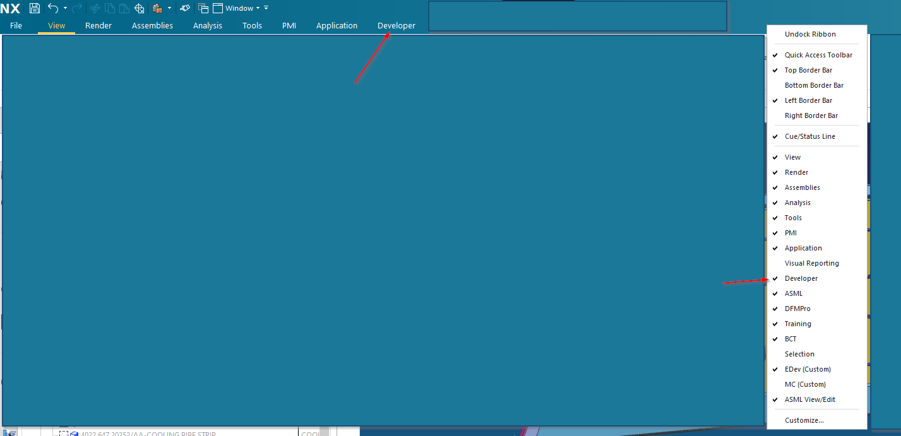
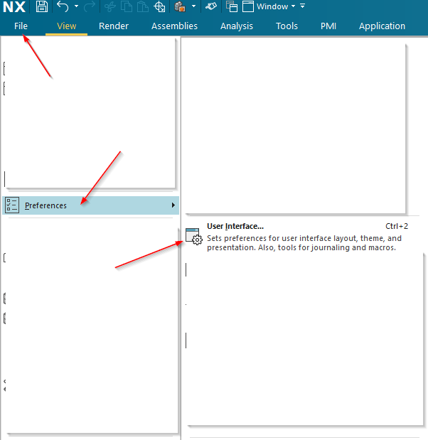
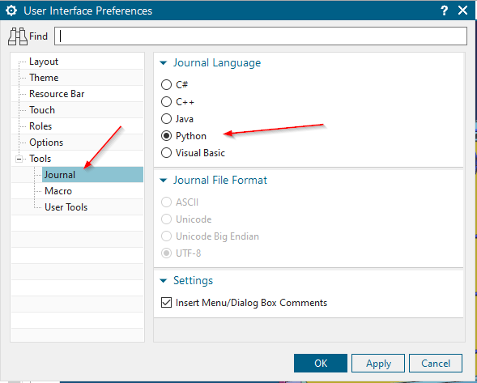
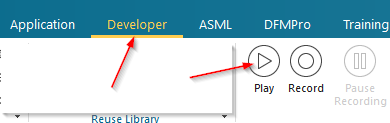
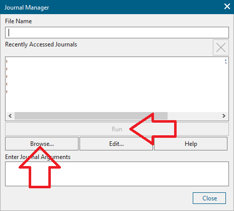
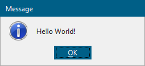
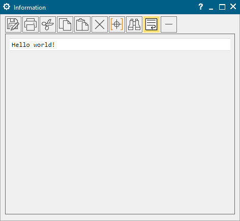
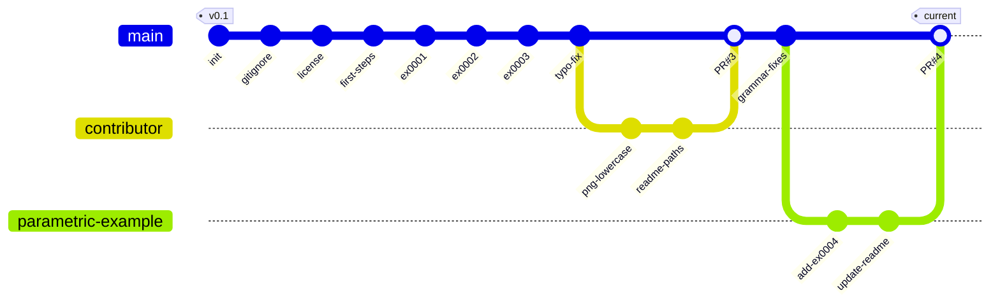

# NXOpen Python Tutorials

[](https://github.com/Foadsf/NXOpen_Python_tutorials/stargazers)
[](https://github.com/Foadsf/NXOpen_Python_tutorials/network/members)
[](https://github.com/sponsors/Foadsf)
[](http://creativecommons.org/publicdomain/zero/1.0/)

A collection of NXOpen Python tutorials for automating Siemens NX CAD/CAM/CAE software.

## Introduction

[NXOpen](https://docs.plm.automation.siemens.com/data_services/resources/nx/10/nx_api/en_US/custom/nxopen_python_ref/index.html) is an Application Programming Interface (API) that gives users access to the Siemens NX/Simcenter 3D model and tool commands, allowing customization and extension of the baseline software capabilities. Applications include:

- Creation and manipulation of part geometry and/or drawings
- Data importing or parsing of model geometry information and analysis results
- Automation of repetitive CAD/CAM/CAE tasks
- Custom feature creation and batch processing

NXOpen can be used with multiple programming languages including C#, C++, Java, Python, and Visual Basic. This repository focuses on **Python** examples.

## Getting Started

### First Steps: Configuring NX for Python

To start with NX Python programming, you need to prepare your NX settings.

**Step 1:** Find or activate the `Developer` tab at the top NX ribbon:

<p align="center">
  
  <br>
  <em>Fig. 1 - Find or activate the Developer tab.</em>
</p>

If the tab does not exist already, right-click on the top ribbon and find the `Developer` tab to activate it.

**Step 2:** Change the macro recording language from Visual Basic to Python.

One great way to develop or learn NX Python programming is to record macros while using the GUI. By default, NX saves macros in Visual Basic. To change that to Python, go to `File > Preferences > User Interface`:

<p align="center">
  
  <br>
  <em>Fig. 2 - Go to the User Interface Preference panel.</em>
</p>

Or press <kbd>Ctrl</kbd> + <kbd>2</kbd> keyboard shortcut. Then in the `User Interface Preferences` dialog, change the `Journal Language` to Python:

<p align="center">
  
  <br>
  <em>Fig. 3 - Change the Journal Language to Python.</em>
</p>

## Tutorials

### Example 1: Hello World! (Message Box)

Let's start with a very simple "Hello World!" example where a message window will show a text message.

```python
# ex0001.py
import NXOpen.UF

def main(): 
    NXOpen.UF.UFSession.GetUFSession().Ui.DisplayMessage("Hello World!", 1)

if __name__ == '__main__':
    main()
```

**Running the code:**

Go to the `Developer` tab and find the `Play` button:

<p align="center">
  
  <br>
  <em>Fig. 4 - Find the Play button.</em>
</p>

In the `Journal Manager` panel, click `Browse` to find and run the code:

<p align="center">
  
  <br>
  <em>Fig. 5 - The Journal Manager panel.</em>
</p>

The result will be:

<p align="center">
  
  <br>
  <em>Fig. 6 - Message box window.</em>
</p>

### Example 2: Hello World! (Listing Window)

The message box window is good for alerting users of specific issues. However, the text is not searchable or selectable. Alternatively, we can use the Listing Window:

```python
# ex0002.py
import NXOpen

def main(): 
    listing_window = NXOpen.Session.GetSession().ListingWindow
    
    listing_window.Open()
    listing_window.WriteFullline("Hello world!")
    listing_window.Close()

if __name__ == '__main__':
    main()
```

The result:

<p align="center">
  
  <br>
  <em>Fig. 7 - Information/Listing window.</em>
</p>

### Example 3: Creating a Cylinder Feature

This example demonstrates how to create 3D geometry programmatically using the CylinderBuilder:

```python
# ex0003.py
import NXOpen
import NXOpen.Features

def cylinder_builder(session=NXOpen.Session.GetSession(), 
                     work_part=NXOpen.Session.GetSession().Parts.Work, 
                     height=100, 
                     diameter=50):
    mark_id = session.SetUndoMark(NXOpen.Session.MarkVisibility.Visible, "Cylinder")
    cylinder = work_part.Features.CreateCylinderBuilder(NXOpen.Features.Feature.Null)
    cylinder.Diameter.SetFormula(str(diameter))
    cylinder.Height.SetFormula(str(height))
    nx_object = cylinder.Commit()
    return nx_object, mark_id

def main():
    cylinder_builder(height=40, diameter=100)

if __name__ == '__main__':
    main()
```

This creates a cylinder with the specified height and diameter that you can edit manually from the model history or update programmatically.

### Example 4: Building a Simple Parametric Yacht

This example combines two `BlockFeatureBuilder` features with NX
expressions to build a simple two-block "yacht": a hull, and a smaller
cabin sitting centered on top of it. Unlike the cylinder in Example 3,
the cabin's dimensions are written as formulas that reference the hull's
own expressions, so resizing the hull updates the cabin proportionally.

```python
# ex0004.py
import NXOpen
import NXOpen.Features

def yacht_builder(session=NXOpen.Session.GetSession(),
                  work_part=NXOpen.Session.GetSession().Parts.Work,
                  yacht_length=25000.0,
                  yacht_width=6000.0,
                  hull_depth=3000.0):
    mark_id = session.SetUndoMark(NXOpen.Session.MarkVisibility.Visible, "Parametric Yacht")
    mm = work_part.UnitCollection.FindObject("MilliMeter")

    # Expressions for the hull's dimensions
    work_part.Expressions.CreateSystemExpressionWithUnits(f"Yacht_Length={yacht_length}", mm)
    work_part.Expressions.CreateSystemExpressionWithUnits(f"Yacht_Width={yacht_width}", mm)
    work_part.Expressions.CreateSystemExpressionWithUnits(f"Hull_Depth={hull_depth}", mm)

    # Hull
    hull_builder = work_part.Features.CreateBlockFeatureBuilder(NXOpen.Features.Feature.Null)
    hull_builder.Type = NXOpen.Features.BlockFeatureBuilder.Types.OriginAndEdgeLengths
    hull_origin = NXOpen.Point3d(0.0, 0.0, 0.0)
    hull_builder.SetOriginAndLengths(hull_origin, "Yacht_Length", "Yacht_Width", "Hull_Depth")
    hull_feature = hull_builder.Commit()
    hull_builder.Destroy()

    # Cabin
    cabin_builder = work_part.Features.CreateBlockFeatureBuilder(NXOpen.Features.Feature.Null)
    cabin_builder.Type = NXOpen.Features.BlockFeatureBuilder.Types.OriginAndEdgeLengths
    cabin_origin = NXOpen.Point3d(float(yacht_length) / 4, 1000.0, float(hull_depth))
    cabin_builder.SetOriginAndLengths(cabin_origin, "Yacht_Length / 2", "Yacht_Width - 2000", "Hull_Depth * 3/4")
    cabin_feature = cabin_builder.Commit()
    cabin_builder.Destroy()

    return hull_feature, cabin_feature, mark_id

def main():
    yacht_builder()

if __name__ == '__main__':
    main()
```

This creates two blocks driven by three named NX expressions
(`Yacht_Length`, `Yacht_Width`, `Hull_Depth`): a hull, and a cabin whose
edge lengths are formulas referencing those same expressions (e.g.
`"Yacht_Length / 2"`). Edit any of the three expressions from the NX
Expressions dialog and both blocks resize together.

Each builder is also explicitly destroyed with `Destroy()` after `Commit()`, which releases the builder's resources. This a good habit once a script starts creating more than one feature.

## Repository Structure

```
NXOpen_Python_tutorials/
├── Examples/
│   ├── ex0001.py    # Message box "Hello World"
│   ├── ex0002.py    # Listing window output
│   ├── ex0003.py    # Cylinder feature creation
│   └── ex0004.py    # Parametric modeling
├── Pictures/        # Screenshots for documentation
├── .gitignore
├── LICENSE          # CC0-1.0 Public Domain
└── README.md
```

## Repository History

This repository was created in August 2021 and has evolved through contributions focused on educational content for NX automation.



### Timeline

**August 2021: Foundation**
- Initial commit with `.gitignore` and CC0 license
- Added "First Steps" guide for NX Python setup
- Created examples `ex0001.py`, `ex0002.py`, and `ex0003.py`
- Fixed variable name typo (`xn_object` → `nx_object`)

**January–February 2022: Standardization**
- File extension standardization (`.PNG` → `.png`) by contributor [@j-eggi](https://github.com/j-eggi)
- README path updates for cross-platform compatibility
- Merged Pull Request #3

**September 2022: Polish**
- Grammar and capitalization fixes
- Improved documentation clarity and formatting

**July 2026: Parametric Modeling**
- Created the parametric-example branch 
- Added ex0004.py for parametric example creation
- Updated the repository history and timeline documentation

## Resources

### Official Documentation
- [NXOpen Python Reference Guide (NX 10)](https://docs.plm.automation.siemens.com/data_services/resources/nx/10/nx_api/en_US/custom/nxopen_python_ref/index.html)
- [NXOpen Python Reference Guide (NX 11)](https://docs.plm.automation.siemens.com/data_services/resources/nx/11/nx_api/custom/en_US/nxopen_python_ref/index.html)
- [NXOpen Getting Started Guide](https://docs.plm.automation.siemens.com/tdoc/nx/12/nx_api)
- [NXOpen Programmer's Guide](https://docs.plm.automation.siemens.com/tdoc/nx/12/nx_api)

### Community Resources
- [NX Journaling Forum](https://www.nxjournaling.com/) - Community Q&A for NX automation
- [Siemens Community](https://community.sw.siemens.com/) - Official Siemens support forums

### Related Articles
- [What Is NX Open? (Explained with examples)](https://engineeryoursound.com/what-is-nx-open-explained-with-examples/)
- [Automating Load Case Combination in Simcenter 3D using NXOpen + Python](https://www.m4-engineering.com/automating-load-case-combination-and-enveloping-in-simcenter-3d-using-nxopen-python/)

## Contributing

Contributions are welcome! If you have NXOpen Python examples you'd like to share:

1. Fork this repository
2. Create a new branch for your feature
3. Add your example to the `Examples/` folder
4. Update the README with documentation
5. Submit a Pull Request

## Support This Project

If you find these tutorials helpful, please consider:

- ⭐ **Starring** the repository
- 🍴 **Forking** and contributing improvements
- 💖 **Sponsoring** via [GitHub Sponsors](https://github.com/sponsors/Foadsf) or [Patreon](https://www.patreon.com/user?u=4281332)

## License

This work is dedicated to the public domain under [CC0 1.0 Universal](http://creativecommons.org/publicdomain/zero/1.0/). You can copy, modify, distribute, and perform the work, even for commercial purposes, all without asking permission.

## Author

**Dr. Foad Sojoodi Farimani**
- GitHub: [@Foadsf](https://github.com/Foadsf)
- Stack Overflow: [Foad S. Farimani](https://stackoverflow.com/users/4999991/foad-s-farimani)
- Twitter: [@fsfarimani](https://x.com/fsfarimani)
- LinkedIn: [fsfarimani](https://www.linkedin.com/in/fsfarimani/)